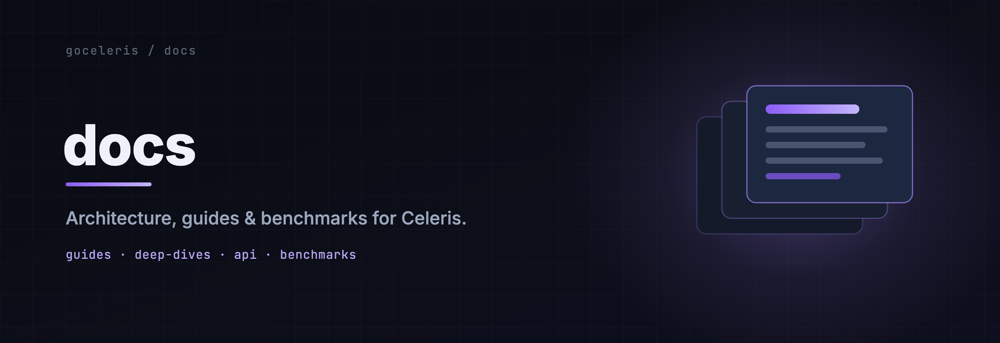

<p align="center">
  
</p>

<p align="center">
  <a href="https://github.com/goceleris/docs/actions/workflows/ci.yml?query=branch%3Amain"></a>
  <a href="https://goceleris.dev"></a>
  <a href="https://codecov.io/gh/goceleris/docs"></a>
  <a href="package.json"></a>
  <a href="package.json"></a>
  <a href="LICENSE"></a>
</p>

<p align="center">
  <strong>The source of <a href="https://goceleris.dev">goceleris.dev</a>:</strong> the documentation, architecture deep-dives
  and benchmark dashboard for <a href="https://github.com/goceleris/celeris">celeris</a>, the HTTP engine for Go.
</p>

<p align="center">
  <a href="https://goceleris.dev/docs/">Documentation</a> ·
  <a href="https://goceleris.dev/benchmarks/">Benchmark dashboard</a> ·
  <a href="https://goceleris.dev/methodology/">Methodology</a> ·
  <a href="#quick-start">Quick start</a>
</p>

## At a glance

**What it is.** The source of [goceleris.dev](https://goceleris.dev): the celeris documentation, the methodology page and the benchmark dashboard, built as a static Astro site with Bun.

**Run it.**

```bash
bun install --frozen-lockfile
bun run dev   # http://localhost:4321
```

**Where the results are.** Benchmark runs are plain files in the [`results/`](results/) tree, written by probatorium's publish step; the dashboard at [goceleris.dev/benchmarks](https://goceleris.dev/benchmarks/) is built from them. What the tree holds is in [Results](#results).

## Why this site

celeris, [loadgen](https://github.com/goceleris/loadgen) and
[probatorium](https://github.com/goceleris/probatorium) are Go repositories. The user documentation and
the published benchmark numbers need a home of their own, with their own review and deploy cycle.
This repository is that home. It builds **goceleris.dev**: the landing page, the user documentation, the
methodology page and the benchmark dashboard. It is a fully static [Astro](https://astro.build) site
with no server: every page is plain HTML generated at build time, and the dashboard is a single
client-only Preact island that loads the per-version JSON the build emitted.

The benchmark data lives in this repository. Each published run is a set of committed files under
[`results/`](results/); the build reads that tree directly and derives every dashboard asset from it,
so there is no database. [probatorium](https://github.com/goceleris/probatorium) measures the runs and
publishes them here. The measured numbers are therefore plain files in git history, and
`bun run validate` checks that every committed cell is well formed. The numbers themselves can only be
re-measured on the benchmark cluster (see [Results](#results)).

## Quick start

Requires [Bun](https://bun.sh) at the version `engines.bun` in [`package.json`](package.json) sets (the
badge above reads it; `>=1.3.0` at the time of writing). Nothing else is needed: `package.json` pins no Node
version, and the build ran with no `node` on `PATH` (checked with Bun 1.3.14).

```bash
bun install --frozen-lockfile
bun run dev     # build:data, then astro dev at http://localhost:4321
bun run demo    # the same, against a synthesized demo dataset for a richer preview
```

To check what CI checks, and to look at the production build locally:

```bash
bun run validate && bun run build && bun run check && bun test
bun run preview # serve the built dist/ at http://localhost:4321
```

- `/` is the landing page with the headline benchmark stats.
- `/docs` is the documentation.
- `/benchmarks` is the dashboard.
- `/methodology` explains how the numbers are made.

`bun run dev` builds the dashboard data from the committed `results/` tree, so it shows the published
runs out of the box. `bun run demo` synthesizes a broader multi-version fixture tree under
`.dev-results/` (gitignored) when you want to exercise more of the dashboard.

## Results

This section says what is published and what it covers. `ls results/` lists the versions. Each version directory holds one or more dated runs, and each run
holds one cell per architecture (the layout is under [Benchmark data pipeline](#benchmark-data-pipeline)).
This is what the tree holds at the time of writing:

| celeris version | Run dates (`results/<version>/<date>/`) | Architectures | On the dashboard |
| --- | --- | --- | --- |
| v1.5.5 | 20260624 | x86_64 | no |
| v1.5.6 | 20260629 | x86_64 | no |
| v1.5.7 | 20260703 | x86_64 | no |
| v1.5.8 | 20260716, 20260722, 20260729, 20260805 | x86_64 | yes |
| v1.5.8 | 20260829 | x86_64 and arm64 | yes |
| v1.6.0 | [[PLACEHOLDER: v1.6.0 results directory, run id]] | pending | not yet |

- **The committed results cover celeris v1.5.5 to v1.5.8, and nothing else.** There is no data for
  v1.5.9, v1.5.10 or v1.5.11 (v1.5.11 is the latest celeris release at the time of writing), and none
  for earlier versions: v1.5.4 and older cells were removed from the tree and survive only in git
  history. A version with no directory here has no run published here; that is not evidence that it was never benchmarked.
- **The dashboard shows v1.5.8 only.** The versions in `DEACTIVATED_VERSIONS`
  ([`scripts/build-data.ts`](scripts/build-data.ts): v1.5.5, v1.5.6 and v1.5.7) stay committed and are
  still checked by `bun run validate`, but they are hidden from the dashboard.
- **What one dashboard number is.** A version's number is the average over every run committed for that
  version and architecture: five x86_64 runs and one arm64 run for v1.5.8. Every committed cell is a
  single run (`runs: 1` in its `benchmark_config`). The 20260716 and 20260829 runs of v1.5.8 last 90 s
  after a 20 s warm-up; the 20260722, 20260729 and 20260805 runs last 35 s after a 10 s warm-up. All
  clear the 30 s smoke threshold (shorter runs are excluded), so all five are averaged together. A run
  covers 52 server columns (celeris and its competitors) over up to 29 scenarios.
- **Limits of the data.** It comes from one three-host cluster (one x86_64 server, one arm64 server and
  one load generator; hardware is on the [methodology](https://goceleris.dev/methodology/) page), so it
  says nothing about other hardware, the arm64 side has a single run, and the v1.5.8 x86_64 average
  mixes runs of two different lengths. The cells record `histograms.json.gz` for provenance, but the
  site does not read them.

### Inspect the data

The commands below need [`jq`](https://jqlang.org) besides Bun.

```bash
ls results/v1.5.8/                                                      # the run dates
jq .benchmark_config results/v1.5.8/20260829/x86_64/summary.json        # run shape, loadgen and celeris versions
jq -r '.benchmarks[].name' results/v1.5.8/20260829/x86_64/summary.json  # the 52 server columns
jq . results/v1.5.8/20260829/x86_64/env.json                            # provenance: git sha, versions, fabric
bun run validate                                                        # check every committed cell
bun run build:data && ls public/data/v/                                 # the payloads the dashboard loads
```

### Reproduce a run

These numbers are measured by probatorium on its cluster, not on a laptop: the bench tier needs the
three-host fabric. How a run is scheduled and what each cell records is in the
[probatorium README](https://github.com/goceleris/probatorium#reproduce-a-run), and the
measurement method is on the [methodology page](https://goceleris.dev/methodology/). What anyone can
reproduce from this repository alone is everything downstream of the committed files: the validation
gate, the aggregation and the dashboard.

## Scripts

Every task is a Bun script (see [`package.json`](package.json)):

| Script | What it does |
| --- | --- |
| `bun run dev` | `build:data`, then `astro dev` (localhost:4321) |
| `bun run demo` | Synthesize demo fixtures, build data from them, then `astro dev` |
| `bun run build` | `build:data` → `astro build` → `pagefind --site dist` → `dist/` |
| `bun run preview` | Serve the built `dist/` locally |
| `bun test` | `scripts/*.test.ts`: the data-layer tests, and a ratchet that keeps docs citing celeris code by symbol, not by line number |
| `bun run validate` | Validate `results/` without emitting anything: the **publish gate** |
| `bun run check` | `astro check` (types and content schema); run `build:data` first |
| `bun run build:data` | Rebuild the dashboard assets from `results/` |
| `bun run demo:data` | Synthesize fixtures, then build data from them |
| `bun run fixtures` | Synthesize the demo fixture tree only |
| `bun run start` | Alias for `bun run dev` |

`validate` runs `build-data --validate-only`. It walks every cell and emits nothing. It exits non-zero
when a cell's `summary.json` or `env.json` fails validation, and with status 2 if it examined no cells
at all, so a gate that inspected nothing can never report success. Problems in `timeseries.json.gz`
are reported as warnings. Unlike `build`, it also scans the versions listed in `DEACTIVATED_VERSIONS`:
hiding a version from the dashboard is a presentation decision, not a licence for its committed data
to rot.

It runs in two places: the `build` job of [`ci.yml`](.github/workflows/ci.yml) on every pull request
and push to `main`, and [`sync-benchmarks.yml`](.github/workflows/sync-benchmarks.yml) on every publish.
`bun run build` deliberately does **not** fail on a bad cell: when a cell's `summary.json` is missing,
unreadable or invalid, it warns, marks the cell `excluded:invalid` and carries on, so one corrupt cell
cannot take the whole deploy down. That is why the separate gate exists.

## Stack

The versions live in [`package.json`](package.json) and [`bun.lock`](bun.lock); the Astro and Bun
badges above read `package.json` on `main`. At the time of writing that is Astro 7.4, Preact 11 and
TypeScript 6.0.3 (pinned exactly on purpose, see [CONTRIBUTING.md](CONTRIBUTING.md)), with Bun 1.3 or
newer.

- **[Astro](https://astro.build)** with `output: 'static'`, built with **Bun**: no SSR and no runtime
  server.
- Integrations: **@astrojs/mdx**, **@astrojs/preact** (`compat: false`) and **@astrojs/sitemap**.
- **Dashboard**: one **Preact + [@preact/signals](https://preactjs.com/guide/v10/signals/)** island under
  [`src/dashboard/`](src/dashboard/), mounted with `client:only="preact"` on the benchmarks page. It
  ships six views in [`views/`](src/dashboard/views/): `HeadToHead`, `Leaderboard`, `Matrix`,
  `OverTime`, `Resources` and `Versions`. The over-time view draws with
  **[uPlot](https://github.com/leeoniya/uPlot)**
  ([`charts/UplotChart.tsx`](src/dashboard/charts/UplotChart.tsx)).
- **Search**: full-text search over the documentation pages with **[Pagefind](https://pagefind.app)**,
  indexed against the built site (`pagefind --site dist`); it degrades silently in dev.
- **Fonts**: self-hosted, subset **Inter** and **JetBrains Mono** through Astro's Fonts API (the
  top-level `fonts` key in [`astro.config.mjs`](astro.config.mjs)), emitted at build time with
  metric-override fallbacks, so there is no runtime font JavaScript and no third-party request.
- **Code**: **[Shiki](https://shiki.style)** highlights at build time with dual themes
  (`github-dark-default` / `github-light-default`), so highlighted code ships as plain HTML.

The canonical URL comes from `SITE_URL` in [`astro.config.mjs`](astro.config.mjs) (default
`https://goceleris.dev`), which drives the sitemap, canonical links and Open Graph URLs.

## Content structure

The documentation is an Astro **content collection**
([`src/content/docs/**/*.{md,mdx}`](src/content/docs/)). Each page's frontmatter is validated against
the schema in [`src/content.config.ts`](src/content.config.ts):

```yaml
---
title: Routing            # required
description: ...          # optional
group: Routing & Handlers # sidebar section (default "Guides")
order: 1                  # sort order within the group (default 100)
draft: false              # default false
---
```

The sidebar groups appear in this order:

1. **Getting Started**: install Celeris, learn the mental model, serve a request
2. **Routing & Handlers**: routes, params, binding, responses, errors, files
3. **Middleware**: the chain and ordering, plus the in-tree catalog
4. **Real-Time**: streaming, Server-Sent Events, WebSocket fan-out
5. **Data & Integration**: database and cache drivers on the event loop, net/http interop
6. **Reference**: every `Config` field, the four I/O engines, the full `Context` API
7. **Operations**: deploy behind TLS, shut down cleanly, observe, tune, test

Pages beyond the docs collection live in [`src/pages/`](src/pages/): the landing page (`index`), the
docs index and article routes (`docs/index`, `docs/[...slug]`), the `benchmarks` dashboard,
`methodology`, a branded `404`, and generated [`llms.txt`](https://llmstxt.org/) / `llms-full.txt`
maps.

## Benchmark data pipeline

`results/` is the **single source of truth**. A cell is laid out as:

```text
results/<version>/<yyyymmdd>/<arch>/
  summary.json          # per-(scenario × server) aggregates: rps, latency percentiles, RSS, CPU
  timeseries.json.gz    # per-second rps / p99 / errors over the run
  histograms.json.gz    # merged HdrHistograms (base64), kept for provenance; the site does not read them yet
  env.json              # run provenance: version, arch, date, run, git ref, celeris and loadgen versions,
                        # run config and the test fabric
```

[`scripts/build-data.ts`](scripts/build-data.ts) walks that tree (override the root with
`RESULTS_ROOT`), validates and loads each cell, averages all runs per `(version, arch)`, and excludes
smoke runs (anything shorter than 30 s) unless `BUILD_INCLUDE_SMOKE=1`. It never crashes on empty or
malformed data: bad cells are skipped with a warning, and an empty tree yields valid empty assets.
Versions in its `DEACTIVATED_VERSIONS` set are left out of the dashboard.

It emits two sets of assets, both **gitignored** and rebuilt on every build:

- `src/data/generated/{manifest,competitors,scenarios}.json`: the versions, the adapter registry and
  the scenario taxonomy
- `public/data/v/<version>/<arch>.json`: one aggregated payload per version and arch

The landing page's headline stats are computed from those assets by [`src/lib/site.ts`](src/lib/site.ts).
The typed data layer that walks, validates and aggregates cells lives in
[`src/lib/results/`](src/lib/results/) and is covered by `bun test`.

### How a benchmark gets published

1. On the cluster, probatorium's `mage Publish` writes the four files of a cell into
   `results/<version>/<yyyymmdd>/<arch>/` of this repository and pushes them to `main` (one commit by
   default; with `PUBLISH_VIA=contents` it writes each file through the GitHub contents API instead).
   It then fires a `repository_dispatch` event of type `benchmark-published` (a small pointer payload:
   `{ version, arch, date, run_id, path, commit }`).
2. That push to `main` is what triggers **Cloudflare Workers Builds**, which rebuilds and redeploys the
   site; the build reads the new `results/` tree.
3. [`sync-benchmarks.yml`](.github/workflows/sync-benchmarks.yml) listens for that dispatch (it can also
   be run by hand) and **verifies** the publish with `contents: read` and no deploy: it checks that the
   cell the pointer describes is committed, retrying a few times while `main` catches up, fails the job
   if it never lands, and then runs `bun run validate` over the tree. It does **not** trigger the
   deploy; the push to `main` already did.

## Deploy and hosting

The site is a **Cloudflare Workers static-assets** deployment: an assets-only Worker (no SSR, no
Worker script), configured in [`wrangler.jsonc`](wrangler.jsonc):

- `name: "goceleris-docs"`, with assets served from `./dist`
- `not_found_handling: "404-page"`, so the branded `dist/404.html` is served (with a 404 status) on
  unknown routes

`wrangler deploy` only uploads a prebuilt `dist/` and does not run the build, so run `bun run build`
first. In production, **Cloudflare Workers Builds** rebuilds and deploys on every push to `main`
(`bun run build` → `dist/`), so a merged publish ships automatically. Nothing in this
repository configures that connection; what the repository records of it are the comments in
[`ci.yml`](.github/workflows/ci.yml) and [`sync-benchmarks.yml`](.github/workflows/sync-benchmarks.yml),
and the `SITE_URL` environment variable (default `https://goceleris.dev`) that `astro.config.mjs` reads.

Caching and crawling are static config:

- [`public/_headers`](public/_headers): content-hashed `/_astro/*` is `immutable`; `/brand`, `/og`,
  `/favicon.svg`, `/pagefind` and `/data` cache for a day; HTML keeps Cloudflare's default of always
  revalidating, so a deploy shows up immediately.
- [`public/robots.txt`](public/robots.txt): allows everything except `/data/`, and points crawlers at
  `https://goceleris.dev/sitemap-index.xml`.

## Repository layout

```text
src/
  content/docs/      # the docs content collection
  dashboard/         # the Preact + uPlot dashboard island (views, charts, state)
  lib/results/       # typed data layer: walk, validate, aggregate, taxonomy
  lib/site.ts        # landing-page headline stats
  pages/             # index, docs, benchmarks, methodology, 404, llms(.full).txt
  layouts/ components/ styles/
scripts/             # build-data and helper CLIs (see below)
results/             # committed benchmark cells: the single source of truth
public/              # static assets, _headers, robots.txt
test/fixtures/       # cell fixtures; sample-cell feeds the data-layer tests (scripts/build-data.test.ts)
.github/workflows/   # ci.yml (the `build` gate), test-coverage.yml, sync-benchmarks.yml
```

### Helper scripts

- [`build-data.ts`](scripts/build-data.ts): the pipeline above (`build:data` / `validate`).
- [`import-run.ts`](scripts/import-run.ts): reshape a raw probatorium run into a `results/` cell (a
  manual bridge; the canonical source stays the probatorium run).
- [`regroup-docs.ts`](scripts/regroup-docs.ts): rewrite each doc's `group` / `order` frontmatter to the
  curated information architecture (idempotent).
- [`dev-fixtures.ts`](scripts/dev-fixtures.ts): synthesize the demo tree under `.dev-results/` from the
  preserved sample cell.
- [`gen-og.ts`](scripts/gen-og.ts) / [`gen-logo.ts`](scripts/gen-logo.ts): render the Open Graph image
  and the brand mark as static assets.

## Status and stability

- **The site is live** at [goceleris.dev](https://goceleris.dev) and is built from `main`. This
  repository is not versioned: `package.json` is `private` at `0.1.0`, and there are no tags or releases.
- **The documentation can lag celeris.** The pages are written by hand against celeris releases and
  can trail the newest one. When a page and the celeris source disagree, the source is right: open an
  issue or a pull request.
- **The published numbers trail celeris too.** The results cover v1.5.5 to v1.5.8 (see
  [Results](#results)); the v1.6.0 entry is
  [[PLACEHOLDER: v1.6.0 results directory, run id]] until a v1.6.0 run is published.
- **CI** ([`ci.yml`](.github/workflows/ci.yml), job `build`) installs with the frozen lockfile, runs
  `bun run validate`, `bun run build`, `bun run check` and `bun test`, and is the required check on
  `main`. Coverage ([`test-coverage.yml`](.github/workflows/test-coverage.yml)) is informational and
  measures only `src/lib/results/`; pages, components and the dashboard have no tests.
- **Known limits.** The dashboard is a client-side island and needs JavaScript. Search uses Pagefind
  over the built site, so it is not available under `bun run dev`. `bun run build` tolerates an invalid
  cell (it warns and excludes it), so only `bun run validate` fails on one.

## Related projects

| Project | What it is |
| --- | --- |
| [celeris](https://github.com/goceleris/celeris) | The HTTP engine for Go that this site documents |
| [loadgen](https://github.com/goceleris/loadgen) | The HTTP/1.1 and HTTP/2 load generator behind the published benchmarks |
| [probatorium](https://github.com/goceleris/probatorium) | The benchmark and validation harness that measures celeris and publishes runs here |

## Contributing

See [CONTRIBUTING.md](CONTRIBUTING.md) for the local checks CI runs and the pull-request flow. Do not
edit `results/` by hand: probatorium commits the cells.

## Security

Report vulnerabilities privately, never in a public issue: see [SECURITY.md](SECURITY.md).

## License

Apache-2.0. See [LICENSE](LICENSE).
